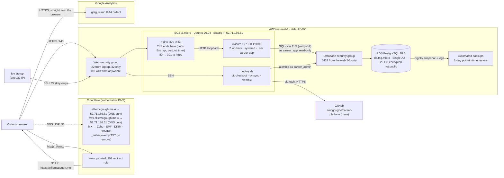
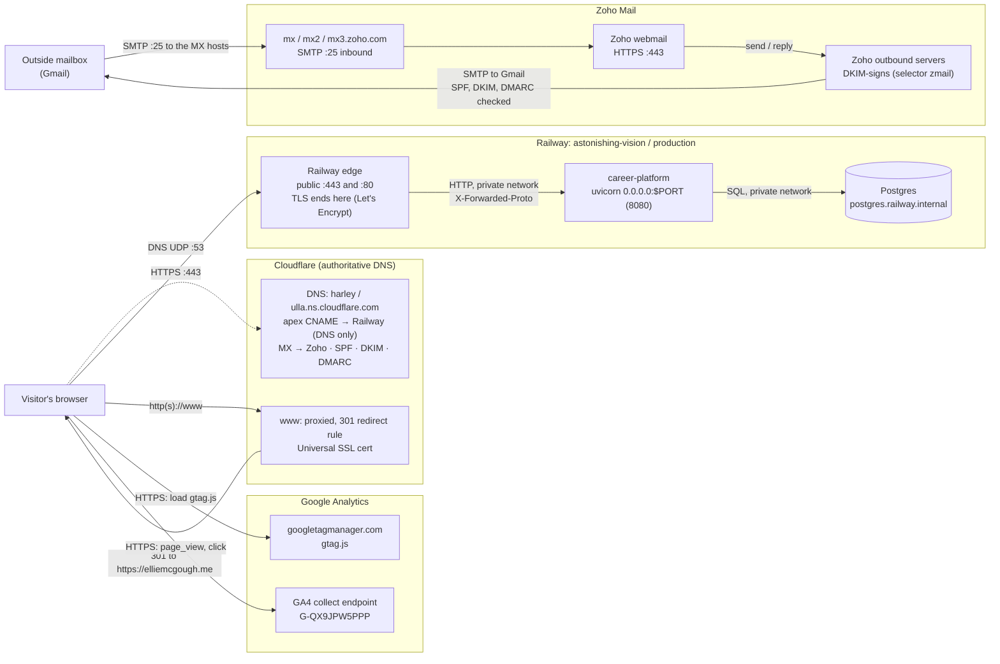
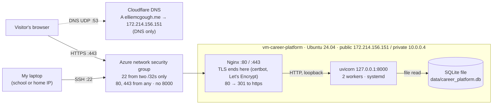

# Career Platform

A FastAPI résumé and portfolio site (`/about`, `/resume`, `/portfolio`, `/projects/<id>`, `/contact`), served at https://elliemcgough.me.

## How it runs

Since 2026-11-09, the site has run on **AWS in `us-east-1`**: one EC2 instance for the app and one Amazon RDS PostgreSQL database. Before that it ran on Railway, and before that on an Azure VM (see the history sections below).

| Piece | What it is |
| --- | --- |
| EC2 instance | `t3.micro`, Ubuntu 26.04, 20 GB encrypted gp3 disk, IMDSv2 required. Elastic IP `52.71.186.61`. |
| nginx | Listens on ports 80 and 443 and is where HTTPS ends. Let's Encrypt certificate for `elliemcgough.me` and `aws.elliemcgough.me`, renewed by `certbot.timer`. Port 80 redirects to HTTPS with a 301. |
| App | uvicorn on `127.0.0.1:8000` with 2 workers, run by systemd (`deploy/aws/career-platform.service`) as the unprivileged user `career-app`. Code in `/opt/career-platform`, with Python 3.14.4 from Ubuntu in a `uv`-built `.venv`. |
| Database | RDS `db.t4g.micro`, PostgreSQL 18.6, Single-AZ (`us-east-1a`), 20 GB gp3, encrypted, **not publicly accessible**, deletion protection on. |
| Database roles | The app connects as `career_app`, which **can only read**. Migrations run as the owner `career_admin`, only from `deploy/aws/deploy.sh`. |
| Database connection | TLS with certificate checking (`sslmode=verify-full`, RDS CA bundle) and `connect_timeout=5`. If the database can't be reached, pages fall back to the saved snapshot with a 503 within about 5 s. |
| Secrets | `/etc/career-platform/app.env` (root:career-app, 640) and `migrate.env` (ubuntu only, 600) on the server. Never in Git. |
| Firewall | Web security group: 22 from my laptop's IP only, 80 and 443 from anywhere. Database security group: 5432 from the web security group only. |
| DNS | Cloudflare. `elliemcgough.me` and `aws.elliemcgough.me` are A records to the Elastic IP, DNS only. `www` is unchanged (proxied, with a 301 to the root domain). |

Each deploy (`deploy/aws/deploy.sh`, run over SSH) goes through these steps:

1. **Check out** the requested commit (`origin/main` by default), detached.
2. **Install** with `uv sync --locked`, using the server's Python (`UV_PYTHON=/usr/bin/python3`).
3. **Migrate** with `alembic upgrade head` as `career_admin` (from `migrate.env`).
4. **Restart** with `systemctl restart career-platform`.
5. **Check** that `/health` answers and `/about` returns 200. If not, the script fails.

## Architecture

The AWS diagram was added on 2026-11-09, from the live resources and the evidence files. The Railway and Azure diagrams were put together on 2026-10-21 and are kept as history. [docs/request-path.md](docs/request-path.md) traces a request step by step, but it still describes Railway.

### Now: AWS EC2 and RDS (since 2026-11-09)



- **Public:** nginx on 80 and 443, Cloudflare, Zoho and Google.
- **Restricted:** SSH, open to my laptop's IP only.
- **Private:** uvicorn (loopback only) and RDS (no public address; it accepts only the web security group).
- **Railway:** no longer part of anything. The app is gone from the account, and only the `_railway-verify` TXT record remains to clean up.
- **Not in the diagram yet:** monitoring and alerts. There aren't any (see [What's next](#whats-next)).

Mail follows the same paths as in the Railway diagram below. It never touches the web host.

### Before: Railway (2026-10-08 to early November 2026)



- **Public:** the Railway edge, Cloudflare, Zoho and Google.
- **Private:** the app's port, and Postgres on Railway's internal network.
- **Never through Railway:** mail and analytics.

### Before that: Azure VM (now shut off)



Zoho (2026-10-13) and GA4 (2026-10-15) were both added after the cutover, so neither ran while the site was on Azure. Neither depends on the web host, so on Azure they would have followed the same paths shown in the Railway diagram.

## Email

Mail for `ellie@elliemcgough.me` is hosted by Zoho Mail, with Cloudflare still the DNS provider. Incoming mail follows the MX records to Zoho. Outgoing mail leaves from Zoho's servers, signed with the `zmail` DKIM key, and passes SPF and DMARC at the receiver. Mail never touches the web host, whether that was Azure, Railway or now AWS.

- Delivery tests (receive, reply, new outgoing) and the authentication results: [docs/evidence/ex06.md](docs/evidence/ex06.md)
- Header analysis and the MX, SPF, DKIM and DMARC records: [docs/evidence/zoho-header-check.md](docs/evidence/zoho-header-check.md)

## Analytics

Every page loads the GA4 tag for `G-QX9JPW5PPP` once, from `templates/base.html` (`839b0c0`). The [privacy page](https://elliemcgough.me/privacy) describes it.

### How a visit reaches Google Analytics

Analytics never passes through my web server or my app. My server only sends HTML that contains the tag. Everything else happens in the visitor's browser:

1. **The page loads.** The browser gets the HTML from my server, which is now EC2. The `<script async src="https://www.googletagmanager.com/gtag/js?id=G-QX9JPW5PPP">` tag makes it fetch `gtag.js` from Google, a separate host with its own DNS lookup and HTTPS connection. `async` means the page doesn't wait for it.
2. **The commands queue.** The inline script creates `window.dataLayer`, a list, and pushes `gtag('js', …)` and `gtag('config', 'G-QX9JPW5PPP')` onto it. Once `gtag.js` has loaded, it reads that list.
3. **`page_view` is sent.** `config` sends a `page_view` for the current address. `gtag.js` sets a first-party `_ga` cookie, so later hits from the same browser count as one user.
4. **`click` is sent.** Enhanced measurement, with Outbound clicks turned on for the web stream, listens for clicks on links to another domain. When a visitor clicks one, it sends a `click` event with `link_url`, `link_domain` and `outbound=true`, along with `page_location` (the page the click came from).
5. **The events go to Google.** The browser sends each event over HTTPS to Google Analytics' collection endpoint (`…/g/collect`), straight from the visitor to Google.
6. **They show up in reports.** GA4 processes them. Realtime shows them within minutes, and standard reports take longer.

If a visitor blocks the script, steps 2–6 don't happen, but the site still works. Nothing in `static/js/site.js` depends on GA4.

### What the checks show

The evidence is in [docs/evidence/ex06.md](docs/evidence/ex06.md) §3, from GA4 Realtime on 2026-10-15.

**Action performed:** on 2026-10-15, in my own browser on the live site, I clicked my LinkedIn link twice and the press kit's Google Drive link once, from the projects page. Then I watched Realtime for the events.

| Check | Observed | What it proves | What it doesn't |
| --- | --- | --- | --- |
| `page_view` in Realtime | 7 at 4:48 PM PDT | The live tag loads and reaches the right property and stream | Who the visitors were, or how many were me |
| `click` in Realtime | 3 at 4:48 PM PDT, matching my 3 clicks | Outbound click measurement is on and firing from the live site | Why a real visitor would click |
| Click details | `link_url` LinkedIn (2) and Google Drive (1), `link_domain` `linkedin.com` and `drive.google.com`, `outbound` `true` (3) | The events describe real links on my site leaving for other domains | What happened on the destination site |
| `page_location` on the click | The projects page | Which page the Drive click came from | |

**Why the outbound click is useful:** it shows which of my links send people somewhere else, such as my LinkedIn profile or a project's press kit. That shows which work gets attention beyond a page view.

**Unverified:** the `…/g/collect` requests weren't captured in the browser's network tab, and DebugView wasn't used. Realtime is the evidence that GA4 received the events.

## Migration from Railway to AWS

These records document the move:
- **Plan:** [docs/superpowers/plans/2026-11-03-aws-ec2-rds-migration.md](docs/superpowers/plans/2026-11-03-aws-ec2-rds-migration.md), written before anything was created.
- **Course guide:** `LMU-ISBA/isba-4775-fa26/guides/aws-migration.md`.
- **Every deviation from the plan:** [docs/migration-notes.md](docs/migration-notes.md).
- **Test evidence:** [docs/evidence/aws-test-subdomain.md](docs/evidence/aws-test-subdomain.md) and [docs/evidence/aws-cutover.md](docs/evidence/aws-cutover.md).

### Which architecture, and why

- **EC2 and RDS, not one server with Postgres on it.** RDS handles Postgres updates, encryption and automated backups with point-in-time restore. The database never has a public address. The app server holds no data, so it can be rebuilt from Git and the two env files.
- **One `t3.micro`, Single-AZ, `db.t4g.micro`.** The course's IAM policy allows only small sizes, and the site is a low-traffic, read-only portfolio. Multi-AZ would double the database cost to protect against an outage the snapshot fallback already handles.
- **nginx in front of uvicorn on loopback.** nginx handles TLS and certbot renewals, and the app port is never on the network. uvicorn trusts forwarded headers only from `127.0.0.1`, so a visitor can't fake `X-Forwarded-Proto`. On Railway it had to trust every proxy.
- **A read-only database role for the app.** The app never writes, so even a compromised app can't change or delete content.
- **Restore run from the EC2 instance.** RDS isn't reachable from outside the VPC, so the dump was copied to the instance and restored with Ubuntu 26.04's Postgres 18 client.
- **Testing on `aws.elliemcgough.me` first.** Every page was checked over HTTPS on a separate name before the main domain moved.

### How the data moved

- **Source:** the Railway Postgres dump `backups/railway-postgres-20261029T215819Z.dump` (`pg_dump -Fc`, Postgres 18.6). A fresh dump at cutover was the plan, but on 2026-11-09 the career-platform app was gone from Railway (see [Investigated failures](#investigated-failures)), so the 2026-10-29 dump was the newest copy. Any edits made on Railway after 2026-10-29 aren't on AWS.
- **Copy:** the dump was copied to EC2 (sha256 matched) and restored into the empty RDS database with `pg_restore --no-owner --no-acl --exit-on-error`, **before** any `alembic upgrade`, so Alembic found `0002_project_category` and did nothing. The server's copy was then shredded.
- **Check:** for every table, a row count plus an md5 of all rows (sorted with `COLLATE "C"`) was compared between RDS and the same dump restored into a local Postgres 18. `diff` was empty. Counts: profiles 1, experiences 2, education 2, skills 13, tags 13, projects 13, project_tags 27, alembic_version 1.

### Backups and restore

| What | Where | How to restore |
| --- | --- | --- |
| RDS automated backups | AWS, daily window 03:13–03:43 UTC, **1-day retention** (the most the Free plan allows) | `aws rds restore-db-instance-to-point-in-time` creates a **new** instance at a chosen time within the last day. Put its host name in both env files on EC2, then restart `career-platform`. |
| Deletion protection | On | Has to be turned off on purpose before the database can be deleted |
| Local dumps | `backups/` on my laptop (git-ignored) | Copy one to EC2 and `pg_restore` into an empty database as `career_admin`, as in plan Section 5 |
| Fresh dump | Taken from EC2 | On the server: `(set -a; . /etc/career-platform/migrate.env; set +a; pg_dump -Fc "$DATABASE_URL" > ~/rds.dump)`. Then `scp` it to `backups/` and `shred -u` the server copy. |

**Not tested:** I haven't tried a point-in-time restore. Only the `pg_restore` path has been exercised, during the migration.

### What was tested on `aws.elliemcgough.me`, and the result

All of these passed on 2026-11-09 ([evidence](docs/evidence/aws-test-subdomain.md)):

| Test | Result |
| --- | --- |
| DNS, certificate and auto-renewal (dry run) | Pass |
| HTTP → HTTPS redirect | Pass |
| All 19 pages identical to the same commit run on the same data | 19 of 19 identical. `/no-such-page` returns 404, the other pages 200, and no page shows the fallback. |
| All 18 static files | 200 |
| `og:image` uses `https://`, even with a fake `X-Forwarded-Proto` | Pass |
| Database outage: security group rule removed, then put back | 503 with the snapshot within 5.3 s, then 200 again within 10 s, without a restart |
| Exposure | Port 8000 and RDS unreachable from the internet. TLS 1.0 and 1.1 refused, 1.2 and 1.3 accepted. |
| On the server | No app errors, 372 MB of memory free, 14% of the disk used, all services enabled |

### Cutover

On 2026-11-09, from 04:24 to 04:27 UTC, the root-domain CNAME to Railway was changed in place to an A record for the Elastic IP (DNS only). The certificate was extended to cover `elliemcgough.me` and its HTTP→HTTPS redirect added. Nothing else in the zone changed. The site had been returning Railway's 404 page before this, so the cutover brought it back ([evidence](docs/evidence/aws-cutover.md)). Then `main` was merged and deployed (`5e3bb00`).

### Who manages what

| Layer | Railway | AWS |
| --- | --- | --- |
| OS and patches | Railway | Me (Ubuntu 26.04, `apt`) |
| Web entry point and TLS | Railway's edge and certificate | Me (nginx, certbot, security groups) |
| Process management | Railway | Me (systemd, `Restart=always`) |
| Deploys | Automatic on every push to `main` | Me, `deploy.sh` over SSH. A push does **not** deploy. |
| Database software, patches, encryption | Railway | AWS (RDS) |
| Backups | Unconfirmed on the trial | RDS automated, 1 day, plus my local dumps |
| Data, roles, recovery | Me | Me |
| DNS | Me (Cloudflare) | Me (Cloudflare) |
| Cost | Trial | Free plan credits (see [Costs](#costs-credits-and-cleanup)) |

## Earlier host: Azure VM

Before Railway, the site ran on an Ubuntu 24.04 VM, `vm-career-platform` (`172.214.156.151` public, `10.0.0.4` private). The VM is now permanently shut off. The setup is recorded in [the Azure migration plan](docs/superpowers/plans/2026-09-24-azure-vm-migration.md) and [the operate-the-VM plan](docs/superpowers/plans/2026-10-01-operate-the-vm.md). HTTPS, certbot and the open ports are covered in [how-this-site-is-secured.md](docs/how-this-site-is-secured.md).

### What brings the site back after a restart

*Written 2026-10-21, after the VM was shut off, from the plans' executed notes.*

On 2026-10-01 the VM had rebooted and the site was down. uvicorn had been started by hand over SSH, so nothing restarted it, and a stale PID file pointed at a dead process (operate-the-VM plan, "VM details"). Four pieces of configuration were added so the site starts on its own:

| Piece | Configuration | What it does at boot |
| --- | --- | --- |
| App service | `/etc/systemd/system/career-platform.service`, enabled with `systemctl enable --now` (Task 2) | `WantedBy=multi-user.target` starts uvicorn at every normal boot. `Restart=always` with `RestartSec=3` brings it back after a crash. It runs as `azureuser`, not root. |
| Workers | `ExecStart=… uvicorn app.main:app --host 127.0.0.1 --port 8000 --workers 2` | Two workers for the VM's 2 vCPUs. If one dies, the parent replaces it while the other keeps serving. `127.0.0.1` keeps port 8000 off the network. |
| Database path | `WorkingDirectory=/home/azureuser/career-platform` and `EnvironmentFile=…/.env`, which holds `DATABASE_URL=sqlite:///./data/career_platform.db` | The relative SQLite path resolves to the real data file. A wrong working directory would make SQLite create a new, empty database, and the site would show the fallback. |
| Nginx | Installed from apt (Task 3). Ubuntu enables it at boot. Site file `/etc/nginx/sites-available/career-platform` | Listens on port 80 (and 443 after certbot) and forwards to `127.0.0.1:8000`. |

These checks were recorded on 2026-10-01: `is-enabled` gave `enabled` for both `career-platform` and `nginx`, `Restart` gave `always`, and two workers were running as `azureuser` on `127.0.0.1:8000` only. The site then served real data with no fallback marker.

**Unverified:** a controlled reboot with the checks repeated afterward was planned (operate-the-VM plan, "After this plan") but never recorded, and the VM can no longer be started to run it. The certbot changes to the Nginx site file for port 443 weren't recorded either, only their results.

## Migration from Azure to Railway

The plan was written before anything changed: [docs/superpowers/plans/2026-10-08-railway-postgres-migration.md](docs/superpowers/plans/2026-10-08-railway-postgres-migration.md) (`5219f59`, 2026-10-08 14:52 PDT). There is no separate spec file for this migration. The plan's "Spec" line quotes the request it was written from.

### What moved, and how

| Item | How it reached Railway |
| --- | --- |
| Application code, templates, static files | Git (`main` on GitHub) |
| Runtime | `.python-version` (3.12), read by Railpack |
| Packages | `requirements.txt`, exported from `uv.lock` (`41128da`), because Railpack installs with pip |
| Build, start and health-check settings | `railpack.json` and `railway.json`, in Git |
| Secrets (`DATABASE_URL`) | Railway variable referencing the Postgres service. Never in Git. |
| Schema | `alembic upgrade head`, run as Railway's pre-deploy step |
| Current data | Not in Git (`data/*.db` is ignored). Copied once with `python -m app.copy_data` from a `.backup` snapshot of the VM's SQLite file (`2351f5f`). |
| DNS | Changed by hand in Cloudflare |

### PostgreSQL compatibility

- `postgresql://` URLs now use the psycopg 3 driver (`fb32663`).
- Tags get a fixed order, because Postgres has no default row order (`0e85bd2`).
- The copy script resets each id sequence to `MAX(id)`, so new rows don't collide with copied ids.
- Every value was checked against its `VARCHAR` limit, which Postgres enforces and SQLite doesn't.
- A throwaway local Postgres 17 ran the migrations and the copy before Railway did (plan, Tasks 1–3 note).

### How current data was preserved

The source was a fresh `.backup` of the live VM database, taken during a content freeze. Before the copy it was checked against the live file (plan, Section 6). After the copy:
- every table's row count matched: profiles 1, experiences 2, education 2, skills 12, tags 13, projects 13, project_tags 27
- every table's SHA-256 row checksum matched
- `alembic_version` matched
- all 17 pages were byte-identical between Railway and the VM (Section 5 note)

**Missing:** no change to the original data, one that seed scripts couldn't reproduce, was recorded before the copy and shown arriving on Railway. The row checksums show the VM's live database was transferred, but they don't show it differed from seed data. The live site lists "WordPress" under Tools, which no seed script adds, but it was probably added on Railway after cutover, so it doesn't count. The VM is now shut off, so this check can't be rerun.

### Cutover

DNS moved before the app was deployed, so the apex served Railway's 404 for up to about 75 minutes on 2026-10-08. The full timeline and post-cutover checks are under Section 8 of the plan, recorded afterward on 2026-10-21. `www` was moved on 2026-10-13/14 to a Cloudflare redirect. See [docs/evidence/dns-https-final.md](docs/evidence/dns-https-final.md).

### Who manages what

| Layer | Azure VM | Railway |
| --- | --- | --- |
| OS and patches | Me (Ubuntu 24.04, `apt`) | Railway |
| Python runtime | Me (`uv` and `.venv` on the VM) | Railway builds it. I choose the version in `.python-version`. |
| Packages | Me (`uv sync --locked`) | Railway installs. I keep `requirements.txt` in step with `uv.lock`. |
| Process management | Me (systemd unit, `Restart=always`) | Railway restarts crashed deploys. I set the start command and health check. |
| Web entry point | Me (Nginx config, NSG rules for 22/80/443) | Railway's edge |
| TLS certificate | Me (certbot and its timer) | Railway issues and renews it |
| Application code | Me | Me |
| Configuration and secrets | Me (`.env` on the VM, mode 600) | Me, in Railway variables |
| Database software | Me (SQLite file on the VM's disk) | Railway runs Postgres |
| Data and backups | Me | Me. Railway stores it, but what's in it, edits, and recovery plans are mine. |
| DNS | Me (Cloudflare) | Me (Cloudflare) |
| Cost and limits | Azure for Students credit | Trial: 30 days or $5, one custom domain |

PaaS removed the server work but not the responsibilities that remain mine:
- code that passes `/health` but breaks pages still deploys
- database content and recovery
- DNS and the `www` redirect
- keeping `railway.json` working past its 2026-12-01 deprecation
- moving off the trial before it ends

## Rollback

### Application code

- **Redeploy a known-good commit:** `ssh ubuntu@52.71.186.61`, then `/opt/career-platform/deploy/aws/deploy.sh <good-commit>`. The script checks out that commit, syncs, migrates, restarts and checks `/health` and `/about`.
- **Through Git:** `git revert <bad-sha>`, push to `main`, then run `deploy.sh` (which deploys `origin/main` by default).
- **Check afterwards:** `curl -s https://elliemcgough.me/about | grep -c 'Showing the latest saved profile snapshot'` should print `0`, and the pages should return 200. Logs are in `journalctl -u career-platform -n 200`.

### Database schema

`deploy.sh` runs `alembic upgrade head` but never downgrades, so rolling back the code doesn't roll back a migration. To undo one, first run `alembic downgrade -1` on the server with `migrate.env` loaded, then redeploy the older commit. Both migrations have `downgrade()` functions. Dropping a column deletes its data, so save it first.

### Data

The app can't write, so the only data changes are my own SQL edits as `career_admin`. Before an edit:
1. Save the rows it will touch.
2. Write the reverse statement.
3. Run the edit in a transaction, check the page, then commit or roll back.

If that isn't enough, use RDS point-in-time restore (within 1 day) or a dump from `backups/` (see [Backups and restore](#backups-and-restore)).

### Earlier hosts (no longer available)

- **Railway:** going back would mean pointing DNS at Railway again, but the career-platform app no longer exists there. A rollback would only bring back the 404.
- **Azure VM:** permanently shut off.

## Decisions

### Move from Railway to AWS EC2 and RDS

- **Chose:** one EC2 instance (nginx, uvicorn, systemd) and a Single-AZ RDS PostgreSQL database, following the course's AWS migration guide.
- **Alternative:** stay on Railway, or move to a paid Railway plan.
- **Why:** the Railway trial was ending, and `railway.json` stops working on 2026-12-01. On AWS, the database is private, encrypted and backed up by RDS, with a read-only role for the app. I control TLS, the firewall and what's exposed.
- **Trade-off:** more work is mine again: OS updates, nginx and certbot, deploys over SSH, and watching the Free plan's credits. Backups are kept for only 1 day on the Free plan.

### Move from the Azure VM to Railway

- **Chose:** Railway, with Railway-hosted PostgreSQL.
- **Alternative:** keep running the site on the Azure VM (Ubuntu, Nginx, certbot, systemd, SQLite).
- **Why:** less server work. There are no OS updates and no certbot to manage, because Railway runs the server and issues the certificate. Content can also be edited in the Railway dashboard's Postgres Data tab, instead of SSHing into the VM and running SQL.
- **Trade-off:** less control, and the trial's limits: 30 days or $5, and one custom domain, so `www` needs a Cloudflare redirect. Data edits and their recovery are still mine (see [Rollback](#rollback)).

### Managed email (Zoho) instead of a self-hosted mail server

- **Chose:** Zoho Mail for `ellie@elliemcgough.me`, with Cloudflare still running DNS.
- **Alternative:** run my own mail server, for example on the Azure VM.
- **Why:** with Zoho, my email doesn't depend on where the website is hosted. Mail kept working through the move to Railway and after the VM was shut off, and it will survive the move to AWS. It also helps avoid spam, since getting mail delivered is hard for a new server with no sending reputation. Zoho handles spam filtering and security updates and runs my mailbox, so I have less to deal with.
- **Trade-off:** Zoho controls the mailbox and its plan limits. I still manage the MX, SPF, DKIM and DMARC records, and even Zoho's mail can land in spam while the domain is new ([ex06.md](docs/evidence/ex06.md)).

## Investigated failures

| Failure | Kind | Symptom | Checks and diagnosis | Repair | Repeated check | Record |
| --- | --- | --- | --- | --- | --- | --- |
| `/` showed only "career-platform is running" | Application, real (2026-09-29) | The home page was a blank page of plain text. The real page was at `/about`. | Compared the code for `/` with the spec. The first build step's placeholder route had never been replaced, and the only test for `/` just checked that it loaded. | `/` redirects to `/about` (`0546382`) | `test_root_route_redirects_to_about` failed first (`200 == 307`) and passed after. On the VM, `/` returned 307 to `/about`, which showed the profile (Azure plan, "Post-plan changes"). | [ex03.md](docs/evidence/ex03.md) §3 |
| Certificate name didn't match the host | DNS/TLS, **deliberate lab simulation** (supplied output, not my domain) | `curl` failed with "certificate subject name does not match" | `dig` showed an A record to the old VM's IP, so the browser reached the old server and got its certificate. A DNS problem caused a TLS error. | Replace the A record with a CNAME to the Railway target | The supplied follow-up showed the CNAME, the right certificate and `HTTP/2 200` | [ex05.md](docs/evidence/ex05.md) |
| Railway deploys failed: `No start command detected` | Migration/deployment, real (2026-10-08) | Three deploys failed before the app started | The build logs showed Railpack ignored `railway.json`'s start command and installed with pip from an unpinned `requirements.txt`, ignoring `uv.lock` | Added `railpack.json` with the same start command (`5488a44`) and pinned `requirements.txt` from `uv.lock` (`41128da`), with tests keeping both in step | The next deploy started, and the live checks passed: 17 pages byte-identical to the VM, no fallback (Railway plan, Section 5 note) | Railway plan, Section 5 |
| Apex served Railway's 404 during cutover | DNS, real (2026-10-08) | `elliemcgough.me` returned "Application not found" | DNS had already been moved to Railway before any deploy worked | The first working deploy at 17:14 PDT | The Section 5 checks on the apex passed | Railway plan, Section 8 note (recorded afterward) |
| Live site returned Railway's `404 Application not found` | Hosting, real (found 2026-11-09) | `https://elliemcgough.me` and the Railway host name `tmbs117o.up.railway.app` both returned 404 | `railway list` showed only one project, `traceability-db`, which belongs to another app. The career-platform project wasn't in the account. Why it disappeared isn't confirmed. | Restored the 2026-10-29 dump into RDS and moved the root domain to EC2 | `https://elliemcgough.me` returns 200 from EC2, with no fallback marker | [migration-notes.md](docs/migration-notes.md), [aws-cutover.md](docs/evidence/aws-cutover.md) |
| `psql` ignored the RDS URL and tried a local socket | Configuration, real (2026-11-09) | `connection to server on socket "/var/run/postgresql/.s.PGSQL.5432" failed` | The env file was loaded with `set -a; . file`. The URL's `&` (between `sslmode=…` and `sslrootcert=…`) sent the line to the background, which cut the value off. | Wrapped `DATABASE_URL` in single quotes in both env files. systemd's `EnvironmentFile` strips them too. | `psql` printed `18.6\|t` (TLS on), and systemd parsed `app.env` correctly | [migration-notes.md](docs/migration-notes.md) |

## Limitations

- **Data is from 2026-10-29.** That was the newest copy left after the Railway app disappeared. Any content edited on Railway after that date isn't on AWS.
- **Fallback snapshot.** When the database is down, pages show the profile from `data/public_profile_snapshot.json` and return 503. That file has to be refreshed by hand after profile edits. The outage behavior was tested live on 2026-11-09 (503 within 5.3 s, then recovery without a restart).
- **`/health` doesn't check the database.** It returned 200 during the outage test, so use `/about` to see whether the data is live.
- **`HEAD` requests get a 405.** The routes are GET-only, so uptime monitors and link checkers must use GET.
- **No HSTS header**, and nginx shows its version in the `Server` header.
- **Backups are kept for only 1 day** (the Free plan's limit). Point-in-time restore hasn't been tested.
- **Single server, Single-AZ, no monitoring.** If the instance or its Availability Zone fails, the site is down until I fix it, and nothing alerts me.
- **Deploys are manual.** A push to `main` doesn't deploy. I have to run `deploy.sh`.
- **SSH depends on my current IP.** When my home IP changes, I have to update the security group rule before I can log in.
- **Content edits are raw SQL** as `career_admin` from the EC2 instance. There's no admin page, and `scripts/*.sql` still use SQLite syntax.
- **Email.** DMARC is `p=none` (monitor only). A reply from Zoho first landed in Gmail spam ([ex06.md](docs/evidence/ex06.md)).
- **Analytics.** Realtime counts include my own test visits, and visitors who block the tag aren't counted. I haven't checked GA4 since the move to AWS.
- **Gaps in the evidence.** Not yet verified on AWS: a reboot, a real certificate renewal, load, and the padlock in a browser. Gaps from the Azure era can't be closed now that the VM is off.

## Costs, credits and cleanup

**AWS** is estimated from the us-east-1 public price list as of 2026-11-03 (on-demand, 730 hours a month). The other rows were checked on 2026-10-21 and haven't been rechecked since, except where marked.

| Item | Monthly |
| --- | --- |
| EC2 `t3.micro` ($0.0104/hr) | $7.59 |
| RDS `db.t4g.micro` Single-AZ ($0.016/hr) | $11.68 |
| EC2 gp3, 20 GB ($0.08/GB-month) | $1.60 |
| RDS gp3, 20 GB ($0.115/GB-month) | $2.30 |
| Public IPv4, Elastic IP ($0.005/hr) | $3.65 |
| Backups (within the free amount) | $0.00 |
| Data out (under 100 GB/month free) | $0.00 |
| **Total** | **about $26.82** |

The AWS account is on the **Free plan: $100 in credits for 6 months**, which at this rate lasts about 113 days. Stopping the instance still bills the Elastic IP and the disks, and a stopped RDS database restarts itself after 7 days.

| Service | What it runs | Plan or credit | Ends or renews | Cleanup plan |
| --- | --- | --- | --- | --- |
| AWS | EC2, RDS, Elastic IP | Free plan, $100 credits | When the credits or the 6 months run out, whichever comes first | At the end of the course, follow the teardown in plan Section 10: final snapshot, delete RDS, terminate EC2, release the Elastic IP, delete the security groups and key pair, and remove the Cloudflare records |
| Railway | Nothing for this site (checked 2026-11-09: the career-platform app is gone) | Trial | About Nov 6–7, 2026 | Remove the `_railway-verify` TXT record and the SSH keys registered with Railway (`isba4775_azure`, and `railway-cli-career-platform` from 2026-11-09). The `traceability-db` project is a different app; leave it alone. |
| Azure for Students | `vm-career-platform` and its resource group (stopped) | $100 credit | Subscription expires Sep 22, 2027 | Delete `rg-career-platform` when the instructor's cleanup directions say so |
| Namecheap | `elliemcgough.me` registration | Free first year | Expires Oct 1, 2027 | Decide before then whether to renew |
| Cloudflare | DNS, `www` redirect | Free plan | None | Keep |
| Zoho Mail | `ellie@elliemcgough.me` | Forever Free | None | Keep |
| Google Analytics 4 | `page_view` and `click` collection | Free | Data kept 14 months | Keep |

**Local cleanup:**
- Delete the untracked `env` file, which holds an old Railway URL.
- `data/*.bak` and the local SQLite copies can go.
- Keep the dumps in `backups/`, because they're the long-term copies while RDS keeps only 1 day.

## What's next

- [ ] **Railway clean-up:** remove the `_railway-verify` TXT record and the Railway SSH keys. Delete the `aws-ec2-rds-migration` branch.
- [ ] **Monitoring:** an uptime check on `https://elliemcgough.me/about` (GET, not HEAD) and an AWS budget alert on the credits.
- [ ] **Not yet verified:** a reboot test (services come back by themselves), the padlock and layout in a browser on a laptop and a phone, GA4 still recording visits, and a point-in-time restore drill.
- [ ] **Docs:** rewrite `docs/how-this-site-is-secured.md` and `docs/request-path.md` for AWS.
- [ ] **Small hardening:** `server_tokens off;`, and decide on HSTS.
- [ ] **Content tooling:** port `scripts/*.sql` to Postgres, or add an admin path.
- [ ] **Teardown at the end of the course** (plan Section 10).

## Reflection

When I started, I had no prior experience with understanding networks and creating my own website from scratch. This helped me to see the chain of separate pieces that go into it and how all parts have to work. It also helped teach me troubleshooting skills and how to identify where an issue is occurring based on what's happening.

Next time, I'd want to work more on understanding each step before moving on and checking what the AI agent did more carefully to learn more and better understand what was happening.

## Deploy

A push to `main` does **not** deploy. To deploy, push to `main`, then:

```bash
ssh -i ~/.ssh/isba4775_aws ubuntu@52.71.186.61
/opt/career-platform/deploy/aws/deploy.sh             # deploys origin/main
/opt/career-platform/deploy/aws/deploy.sh <commit>    # or a specific commit (rollback)
journalctl -u career-platform -n 100                  # logs
```

If SSH times out, my IP has probably changed. Update the port 22 rule on the web security group to the new `/32` with the AWS CLI (profile `isba-4775`).

`railway.json`, `railpack.json` and `tests/test_railway_config.py` are left over from Railway and no longer used.

## Dependencies

`pyproject.toml` and `uv.lock` are the source of truth. The server installs with `uv sync --locked`, using Ubuntu's Python 3.14. `.python-version` (3.12) is only for local development and the old Railway build, and `uv.lock` has wheels for 3.12 to 3.14.

```bash
uv add <package>
```

`requirements.txt` was only for Railway's pip install. `tests/test_requirements.py` still checks that it's pinned. To keep it in step anyway:

```bash
uv export --format requirements-txt --no-hashes --no-emit-project --locked -o requirements.txt
```

## Edit content

Content lives in the RDS database, and there's no admin page. Pages read the database on every request, so changes show up without a redeploy. RDS can only be reached from the EC2 instance, and the app's role can only read, so edits are made **on the server as `career_admin`**:

```bash
ssh -i ~/.ssh/isba4775_aws ubuntu@52.71.186.61
(set -a; . /etc/career-platform/migrate.env; set +a; psql "$DATABASE_URL")
```

New tables are readable by `career_app` automatically, through `ALTER DEFAULT PRIVILEGES`. The scripts in `scripts/*.sql` use SQLite syntax (`PRAGMA`, `INSERT OR IGNORE`), so convert them before running them on RDS. Follow the steps in [Rollback → Data](#data) before any edit.

If the database can't be reached, public pages fall back to `data/public_profile_snapshot.json`. The HTML then contains the comment `Showing the latest saved profile snapshot.`, so `/health` returning 200 doesn't on its own prove the data is live.

## Local development

Locally the app uses SQLite (`sqlite:///./career_platform.db` unless `DATABASE_URL` says otherwise):

```bash
uv sync
uv run alembic upgrade head
sqlite3 career_platform.db < scripts/seed_profile.sql
uv run uvicorn app.main:app --reload
uv run pytest
```

To run against Postgres instead, set `DATABASE_URL` to a `postgresql://` or `postgres://` URL. The app switches it to the psycopg 3 driver.

`python -m app.copy_data <source_url> <target_url>` copies every table from one database into an empty one on the same migration. It was used for the one-time move from the VM's SQLite file to Railway.
