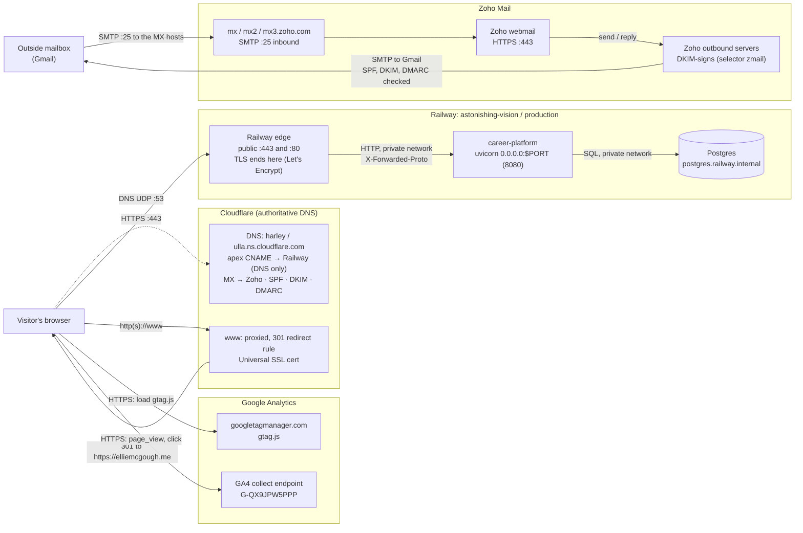
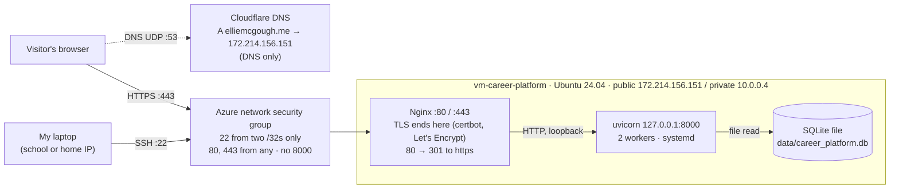

# Career Platform

A FastAPI résumé and portfolio site (`/about`, `/resume`, `/portfolio`, `/projects/<id>`, `/contact`), served at https://elliemcgough.me.

## How it runs

The site runs on [Railway](https://railway.com), in the project `astonishing-vision`, environment `production`:

| Service | What it is |
| --- | --- |
| `career-platform` | The web app. Its `DATABASE_URL` is a reference to the Postgres service's private URL (`postgres.railway.internal`). |
| `Postgres` | The site's data. The schema comes from the Alembic migrations in `alembic/versions/`. |

Each deploy goes through these steps:

1. **Build.** Railpack installs Python 3.12 (from `.python-version`) and runs `pip install -r requirements.txt`. It starts the app with the command in `railpack.json`.
2. **Pre-deploy.** `railway.json` runs `alembic upgrade head`. If the migration fails, the new deploy stops and the previous one keeps serving.
3. **Start.** uvicorn listens on `0.0.0.0:$PORT` (Railway sets 8080) and trusts Railway's proxy headers, so the URLs the app builds use `https://`.
4. **Health check.** Railway checks `/health` before sending traffic to the new deploy. `/health` doesn't touch the database.

`railpack.json` and `railway.json` must have the same start command; `tests/test_railway_config.py` checks this.

DNS is on Cloudflare. `elliemcgough.me` is a CNAME to Railway, set to DNS only (grey cloud), and Railway issues and renews the certificate. `www.elliemcgough.me` is a proxied placeholder record, and a Cloudflare redirect rule sends both `http://www` and `https://www` to `https://elliemcgough.me` with a 301. The records, the rule, and the certificate checks are in [docs/evidence/dns-https-final.md](docs/evidence/dns-https-final.md).

## Architecture

Assembled 2026-10-21 from the plans and evidence files. A step-by-step request trace is in [docs/request-path.md](docs/request-path.md).

### Now: Railway, with email and analytics



- **Public:** the Railway edge, Cloudflare, Zoho and Google.
- **Private:** the app's port, and Postgres on Railway's internal network.
- **Never through Railway:** mail and analytics.

### Before: Azure VM (now shut off)



Zoho (2026-10-13) and GA4 (2026-10-15) were both added after the cutover, so neither ran while the site was on Azure. Neither depends on the web host, so on Azure they would have followed the same paths shown in the Railway diagram.

## Email

Mail for `ellie@elliemcgough.me` is hosted by Zoho Mail, with Cloudflare still the DNS provider. Incoming mail follows the MX records to Zoho. Outgoing mail leaves from Zoho's servers, signed with the `zmail` DKIM key, and passes SPF and DMARC at the receiver. Mail never touches Railway.

- Delivery tests (receive, reply, new outgoing) and the authentication results: [docs/evidence/ex06.md](docs/evidence/ex06.md)
- Header analysis and the MX, SPF, DKIM and DMARC records: [docs/evidence/zoho-header-check.md](docs/evidence/zoho-header-check.md)

## Analytics

Every page loads the GA4 tag for `G-QX9JPW5PPP` once, from `templates/base.html` (`839b0c0`). The [privacy page](https://elliemcgough.me/privacy) describes it.

### How a visit reaches Google Analytics

Analytics never passes through Railway or my app. My server only sends HTML that contains the tag. Everything else happens in the visitor's browser:

1. **The page loads.** The browser gets the HTML from Railway. The `<script async src="https://www.googletagmanager.com/gtag/js?id=G-QX9JPW5PPP">` tag makes it fetch `gtag.js` from Google, a separate host with its own DNS lookup and HTTPS connection. `async` means the page doesn't wait for it.
2. **The commands queue.** The inline script creates `window.dataLayer`, a list, and pushes `gtag('js', …)` and `gtag('config', 'G-QX9JPW5PPP')` onto it. Once `gtag.js` has loaded, it reads that list.
3. **`page_view` is sent.** `config` sends a `page_view` for the current address. `gtag.js` sets a first-party `_ga` cookie, so later hits from the same browser count as one user.
4. **`click` is sent.** Enhanced measurement, with Outbound clicks turned on for the web stream, listens for clicks on links to another domain. When a visitor clicks one, it sends a `click` event with `link_url`, `link_domain` and `outbound=true`, along with `page_location` (the page the click came from).
5. **The events go to Google.** The browser sends each event over HTTPS to Google Analytics' collection endpoint (`…/g/collect`), straight from the visitor to Google.
6. **They show up in reports.** GA4 processes them. Realtime shows them within minutes, and standard reports take longer.

If a visitor blocks the script, steps 2–6 don't happen, but the site still works. Nothing in `static/js/site.js` depends on GA4.

### What the checks show

The evidence is in [docs/evidence/ex06.md](docs/evidence/ex06.md) §3, from GA4 Realtime on 2026-10-15.

**Action performed:** on 2026-10-15, in my own browser on the live site, I clicked my LinkedIn link twice and the press kit's Google Drive link once, from the projects page. Then I watched Realtime for the events.

| Check | Observed | What it proves | What it doesn't |
| --- | --- | --- | --- |
| `page_view` in Realtime | 7 at 4:48 PM PDT | The live tag loads and reaches the right property and stream | Who the visitors were, or how many were me |
| `click` in Realtime | 3 at 4:48 PM PDT, matching my 3 clicks | Outbound click measurement is on and firing from the live site | Why a real visitor would click |
| Click details | `link_url` LinkedIn (2) and Google Drive (1), `link_domain` `linkedin.com` and `drive.google.com`, `outbound` `true` (3) | The events describe real links on my site leaving for other domains | What happened on the destination site |
| `page_location` on the click | The projects page | Which page the Drive click came from | |

**Why the outbound click is useful:** it shows which of my links send people somewhere else, such as my LinkedIn profile or a project's press kit. That shows which work gets attention beyond a page view.

**Unverified:** the `…/g/collect` requests weren't captured in the browser's network tab, and DebugView wasn't used. Realtime is the evidence that GA4 received the events.

## Earlier host: Azure VM

Before Railway, the site ran on an Ubuntu 24.04 VM, `vm-career-platform` (`172.214.156.151` public, `10.0.0.4` private). The VM is now permanently shut off. The setup is recorded in [the Azure migration plan](docs/superpowers/plans/2026-09-24-azure-vm-migration.md) and [the operate-the-VM plan](docs/superpowers/plans/2026-10-01-operate-the-vm.md). HTTPS, certbot and the open ports are covered in [how-this-site-is-secured.md](docs/how-this-site-is-secured.md).

### What brings the site back after a restart

*Written 2026-10-21, after the VM was shut off, from the plans' executed notes.*

On 2026-10-01 the VM had rebooted and the site was down. uvicorn had been started by hand over SSH, so nothing restarted it, and a stale PID file pointed at a dead process (operate-the-VM plan, "VM details"). Four pieces of configuration were added so the site starts on its own:

| Piece | Configuration | What it does at boot |
| --- | --- | --- |
| App service | `/etc/systemd/system/career-platform.service`, enabled with `systemctl enable --now` (Task 2) | `WantedBy=multi-user.target` starts uvicorn at every normal boot. `Restart=always` with `RestartSec=3` brings it back after a crash. It runs as `azureuser`, not root. |
| Workers | `ExecStart=… uvicorn app.main:app --host 127.0.0.1 --port 8000 --workers 2` | Two workers for the VM's 2 vCPUs. If one dies, the parent replaces it while the other keeps serving. `127.0.0.1` keeps port 8000 off the network. |
| Database path | `WorkingDirectory=/home/azureuser/career-platform` and `EnvironmentFile=…/.env`, which holds `DATABASE_URL=sqlite:///./data/career_platform.db` | The relative SQLite path resolves to the real data file. A wrong working directory would make SQLite create a new, empty database, and the site would show the fallback. |
| Nginx | Installed from apt (Task 3). Ubuntu enables it at boot. Site file `/etc/nginx/sites-available/career-platform` | Listens on port 80 (and 443 after certbot) and forwards to `127.0.0.1:8000`. |

These checks were recorded on 2026-10-01: `is-enabled` gave `enabled` for both `career-platform` and `nginx`, `Restart` gave `always`, and two workers were running as `azureuser` on `127.0.0.1:8000` only. The site then served real data with no fallback marker.

**Unverified:** a controlled reboot with the checks repeated afterward was planned (operate-the-VM plan, "After this plan") but never recorded, and the VM can no longer be started to run it. The certbot changes to the Nginx site file for port 443 weren't recorded either, only their results.

## Migration from Azure to Railway

The plan was written before anything changed: [docs/superpowers/plans/2026-10-08-railway-postgres-migration.md](docs/superpowers/plans/2026-10-08-railway-postgres-migration.md) (`5219f59`, 2026-10-08 14:52 PDT). There is no separate spec file for this migration. The plan's "Spec" line quotes the request it was written from.

### What moved, and how

| Item | How it reached Railway |
| --- | --- |
| Application code, templates, static files | Git (`main` on GitHub) |
| Runtime | `.python-version` (3.12), read by Railpack |
| Packages | `requirements.txt`, exported from `uv.lock` (`41128da`), because Railpack installs with pip |
| Build, start and health-check settings | `railpack.json` and `railway.json`, in Git |
| Secrets (`DATABASE_URL`) | Railway variable referencing the Postgres service. Never in Git. |
| Schema | `alembic upgrade head`, run as Railway's pre-deploy step |
| Current data | Not in Git (`data/*.db` is ignored). Copied once with `python -m app.copy_data` from a `.backup` snapshot of the VM's SQLite file (`2351f5f`). |
| DNS | Changed by hand in Cloudflare |

### PostgreSQL compatibility

- `postgresql://` URLs now use the psycopg 3 driver (`fb32663`).
- Tags get a fixed order, because Postgres has no default row order (`0e85bd2`).
- The copy script resets each id sequence to `MAX(id)`, so new rows don't collide with copied ids.
- Every value was checked against its `VARCHAR` limit, which Postgres enforces and SQLite doesn't.
- A throwaway local Postgres 17 ran the migrations and the copy before Railway did (plan, Tasks 1–3 note).

### How current data was preserved

The source was a fresh `.backup` of the live VM database, taken during a content freeze. Before the copy it was checked against the live file (plan, Section 6). After the copy:
- every table's row count matched: profiles 1, experiences 2, education 2, skills 12, tags 13, projects 13, project_tags 27
- every table's SHA-256 row checksum matched
- `alembic_version` matched
- all 17 pages were byte-identical between Railway and the VM (Section 5 note)

**Missing:** no change to the original data, one that seed scripts couldn't reproduce, was recorded before the copy and shown arriving on Railway. The row checksums show the VM's live database was transferred, but they don't show it differed from seed data. The live site lists "WordPress" under Tools, which no seed script adds, but it was probably added on Railway after cutover, so it doesn't count. The VM is now shut off, so this check can't be rerun.

### Cutover

DNS moved before the app was deployed, so the apex served Railway's 404 for up to about 75 minutes on 2026-10-08. The full timeline and post-cutover checks are under Section 8 of the plan, recorded afterward on 2026-10-21. `www` was moved on 2026-10-13/14 to a Cloudflare redirect. See [docs/evidence/dns-https-final.md](docs/evidence/dns-https-final.md).

### Who manages what

| Layer | Azure VM | Railway |
| --- | --- | --- |
| OS and patches | Me (Ubuntu 24.04, `apt`) | Railway |
| Python runtime | Me (`uv` and `.venv` on the VM) | Railway builds it. I choose the version in `.python-version`. |
| Packages | Me (`uv sync --locked`) | Railway installs. I keep `requirements.txt` in step with `uv.lock`. |
| Process management | Me (systemd unit, `Restart=always`) | Railway restarts crashed deploys. I set the start command and health check. |
| Web entry point | Me (Nginx config, NSG rules for 22/80/443) | Railway's edge |
| TLS certificate | Me (certbot and its timer) | Railway issues and renews it |
| Application code | Me | Me |
| Configuration and secrets | Me (`.env` on the VM, mode 600) | Me, in Railway variables |
| Database software | Me (SQLite file on the VM's disk) | Railway runs Postgres |
| Data and backups | Me | Me. Railway stores it, but what's in it, edits, and recovery plans are mine. |
| DNS | Me (Cloudflare) | Me (Cloudflare) |
| Cost and limits | Azure for Students credit | Trial: 30 days or $5, one custom domain |

PaaS removed the server work but not the responsibilities that remain mine:
- code that passes `/health` but breaks pages still deploys
- database content and recovery
- DNS and the `www` redirect
- keeping `railway.json` working past its 2026-12-01 deprecation
- moving off the trial before it ends

## Rollback

### Application code

- **Fastest:** in the Railway dashboard, open the `career-platform` deployments, click the three dots on the last good deployment, and choose Rollback. Railway restores that deployment's image and its variables ([Railway docs](https://docs.railway.com/deployments/deployment-actions)). Deployments older than the plan's retention period can't be rolled back this way.
- **Through Git:** `git revert <bad-sha>` and push to `main`. That deploys a new commit with the bad change undone, and the history stays honest.
- **Check afterward:** `curl -s https://elliemcgough.me/about | grep -c 'Showing the latest saved profile snapshot'` should print `0`, and the pages should return 200, not 503.

### Database schema

The pre-deploy step runs `alembic upgrade head` but never downgrades. Rolling back code does not roll back a migration. Before rolling back past a migration, downgrade first from inside Railway (for example `railway ssh --service career-platform -- alembic downgrade -1`), then roll back the code. Both migrations so far have `downgrade()` functions. Dropping a column also deletes its data, so save that column first.

### Data

The app doesn't write to the database, so data changes only come from my own SQL edits. Before an edit:
1. Save the rows it will touch (`SELECT …`) so I have the exact old values.
2. Write the reverse statement before running the change.
3. Run the edit inside a transaction, check the page, then commit or roll back.

**Unverified:** whether Railway's Postgres backups are available on this plan. Check the Postgres service's Backups tab before relying on them.

### At cutover (no longer available)

The VM was kept running as the rollback target. The undo was to put the A records back to `172.214.156.151` (DNS only). The VM still had the SQLite data as of the freeze. Any content edited on Railway after cutover would have had to be reapplied to the VM's SQLite file, then confirmed with the same row-count and checksum comparison used for the migration. No rollback was needed. The VM is now permanently shut off, so this path is gone.

## Decisions

### Move from the Azure VM to Railway

- **Chose:** Railway, with Railway-hosted PostgreSQL.
- **Alternative:** keep running the site on the Azure VM (Ubuntu, Nginx, certbot, systemd, SQLite).
- **Why:** less server work. There are no OS updates and no certbot to manage, because Railway runs the server and issues the certificate. Content can also be edited in the Railway dashboard's Postgres Data tab, instead of SSHing into the VM and running SQL.
- **Trade-off:** less control, and the trial's limits: 30 days or $5, and one custom domain, so `www` needs a Cloudflare redirect. Data edits and their recovery are still mine (see [Rollback](#rollback)).

### Managed email (Zoho) instead of a self-hosted mail server

- **Chose:** Zoho Mail for `ellie@elliemcgough.me`, with Cloudflare still running DNS.
- **Alternative:** run my own mail server, for example on the Azure VM.
- **Why:** with Zoho, my email doesn't depend on where the website is hosted. Mail kept working through the move to Railway and after the VM was shut off, and it will survive the move to AWS. It also helps avoid spam, since getting mail delivered is hard for a new server with no sending reputation. Zoho handles spam filtering and security updates and runs my mailbox, so I have less to deal with.
- **Trade-off:** Zoho controls the mailbox and its plan limits. I still manage the MX, SPF, DKIM and DMARC records, and even Zoho's mail can land in spam while the domain is new ([ex06.md](docs/evidence/ex06.md)).

## Investigated failures

| Failure | Kind | Symptom | Checks and diagnosis | Repair | Repeated check | Record |
| --- | --- | --- | --- | --- | --- | --- |
| `/` showed only "career-platform is running" | Application, real (2026-09-29) | The home page was a blank page of plain text. The real page was at `/about`. | Compared the code for `/` with the spec. The first build step's placeholder route had never been replaced, and the only test for `/` just checked that it loaded. | `/` redirects to `/about` (`0546382`) | `test_root_route_redirects_to_about` failed first (`200 == 307`) and passed after. On the VM, `/` returned 307 to `/about`, which showed the profile (Azure plan, "Post-plan changes"). | [ex03.md](docs/evidence/ex03.md) §3 |
| Certificate name didn't match the host | DNS/TLS, **deliberate lab simulation** (supplied output, not my domain) | `curl` failed with "certificate subject name does not match" | `dig` showed an A record to the old VM's IP, so the browser reached the old server and got its certificate. A DNS problem caused a TLS error. | Replace the A record with a CNAME to the Railway target | The supplied follow-up showed the CNAME, the right certificate and `HTTP/2 200` | [ex05.md](docs/evidence/ex05.md) |
| Railway deploys failed: `No start command detected` | Migration/deployment, real (2026-10-08) | Three deploys failed before the app started | The build logs showed Railpack ignored `railway.json`'s start command and installed with pip from an unpinned `requirements.txt`, ignoring `uv.lock` | Added `railpack.json` with the same start command (`5488a44`) and pinned `requirements.txt` from `uv.lock` (`41128da`), with tests keeping both in step | The next deploy started, and the live checks passed: 17 pages byte-identical to the VM, no fallback (Railway plan, Section 5 note) | Railway plan, Section 5 |
| Apex served Railway's 404 during cutover | DNS, real (2026-10-08) | `elliemcgough.me` returned "Application not found" | DNS had already been moved to Railway before any deploy worked | The first working deploy at 17:14 PDT | The Section 5 checks on the apex passed | Railway plan, Section 8 note (recorded afterward) |

## Limitations

- **Fallback snapshot.** When the database is down, pages show the profile from `data/public_profile_snapshot.json` and return 503. That file must be refreshed by hand after profile edits, or an outage shows old details. It was refreshed from the live profile in [`4f9fdc8`](https://github.com/emcgough4/career-platform/commit/4f9fdc8) (projects left empty, so an outage says "Projects temporarily unavailable"). A live outage and recovery has not been tested.
- **`/health` doesn't check the database.** A deploy with a broken database connection still passes Railway's health check.
- **Railway trial.** It ends after 30 days or $5 of usage, and allows one custom domain, so `www` relies on a Cloudflare redirect. `railway.json` stops working on 2026-12-01. The site moves to AWS after the midterm.
- **No verified database backups.** Whether Railway backs up this Postgres service on the trial isn't confirmed.
- **Content edits are raw SQL.** There is no admin page, and `scripts/*.sql` still use SQLite syntax.
- **Email.** DMARC is `p=none` (monitor only). A reply from Zoho first landed in Gmail spam ([ex06.md](docs/evidence/ex06.md)).
- **Analytics.** The Realtime counts include my own test visits. Visitors who block the tag aren't counted.
- **Gaps in the evidence.** These can't be closed now that the VM is off: the Azure restart test, the certbot Nginx configuration, and a data change made before the migration.

## Costs, credits and cleanup

Checked 2026-10-21. Balances come from each provider's account page. Resource states come from `az` and `whois`.

| Service | What it runs | Plan or credit | Used so far | Ends or renews | Cleanup plan |
| --- | --- | --- | --- | --- | --- |
| Railway | Web app and Postgres (compute plus the database's storage volume) | Trial: $5 credit or 30 days, started Oct 7, 2026 | $0.75 ($4.25 left). At this rate about $0.90 more by the end date. | About Nov 6–7, 2026 (date runs out before credit) | Move to AWS after the midterm, before the trial ends. Then remove the Railway project and the `isba4775_azure` SSH key registered with Railway on 2026-10-21. |
| Azure for Students | `vm-career-platform` and its resource group | $100 credit | $5 ($95 left) | Subscription expires Sep 22, 2027 | The VM is stopped (deallocated), so compute isn't billed. Its OS disk (StandardSSD) and Standard static public IP still draw on credit. Delete `rg-career-platform` when the instructor's cleanup directions say so. |
| Namecheap | `elliemcgough.me` registration | Free first year | $0 | Expires Oct 1, 2027 | Decide before then whether to renew at the normal `.me` price |
| Cloudflare | DNS, `www` redirect, Universal SSL for `www` | Free plan | $0 | None | Keep as DNS provider |
| Zoho Mail | `ellie@elliemcgough.me` | Forever Free | $0 | None | Keep |
| Google Analytics 4 | `page_view` and `click` collection | Free | $0 | Data kept 14 months (privacy page) | Keep |

**Compute vs storage:**
- Railway bills both the running service and the Postgres volume.
- On Azure, the stopped VM bills nothing for compute, but its disk and IP still bill.
- The domain is the only cost that renews on a schedule.

**Local cleanup:**
- The untracked `env` file holds an old Railway public database URL that no longer works. Delete it.
- `data/*.bak` and the local SQLite copies are gitignored. They can go once the AWS move is done.

## Reflection

When I started, I had no prior experience with understanding networks and creating my own website from scratch. This helped me to see the chain of separate pieces that go into it and how all parts have to work. It also helped teach me troubleshooting skills and how to identify where an issue is occurring based on what's happening.

Next time, I'd want to work more on understanding each step before moving on and checking what the AI agent did more carefully to learn more and better understand what was happening.

## Deploy

Every push to `main` on GitHub deploys automatically. To deploy local changes without pushing, or to check on a deploy, use the [Railway CLI](https://docs.railway.com/guides/cli):

```bash
railway login
railway link          # project astonishing-vision, environment production
railway up --service career-platform --ci     # deploy the working tree without pushing
railway deployment list --service career-platform
railway logs --service career-platform
```

## Dependencies

`pyproject.toml` and `uv.lock` are the source of truth. Railway installs from `requirements.txt` with pip, so after any dependency change, regenerate that file from the lock:

```bash
uv add <package>
uv export --format requirements-txt --no-hashes --no-emit-project --locked -o requirements.txt
```

`tests/test_requirements.py` fails if any line in `requirements.txt` isn't pinned.

## Edit content

Content lives in the Railway Postgres database; there is no admin page. Pages read the database on every request, so changes show up without a redeploy.

```bash
railway connect Postgres     # opens psql (needs psql on PATH)
```

`railway run --service Postgres -- <command>` gives a single command the database URL in `$DATABASE_PUBLIC_URL`, so the password is never typed or saved.

The scripts in `scripts/*.sql` use SQLite syntax (`PRAGMA`, `INSERT OR IGNORE`). Convert them to Postgres syntax before running them against Railway.

If the database can't be reached, public pages fall back to `data/public_profile_snapshot.json`. The HTML then contains the comment `Showing the latest saved profile snapshot.`, so `/health` returning 200 does not by itself prove the data is live.

## Local development

Locally the app uses SQLite (`sqlite:///./career_platform.db` unless `DATABASE_URL` says otherwise):

```bash
uv sync
uv run alembic upgrade head
sqlite3 career_platform.db < scripts/seed_profile.sql
uv run uvicorn app.main:app --reload
uv run pytest
```

To run against Postgres instead, set `DATABASE_URL` to a `postgresql://` or `postgres://` URL. The app switches it to the psycopg 3 driver.

`python -m app.copy_data <source_url> <target_url>` copies every table from one database into an empty one on the same migration. It was used for the one-time move from the VM's SQLite file to Railway.
