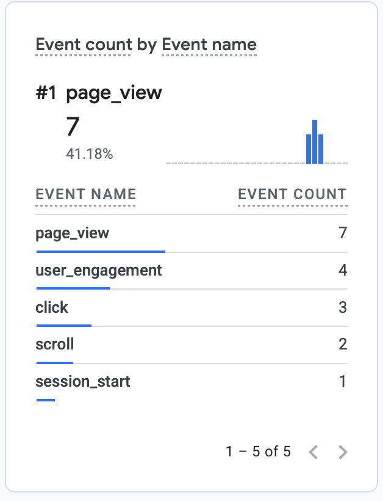
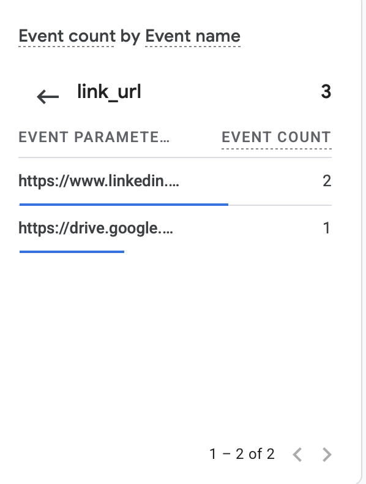
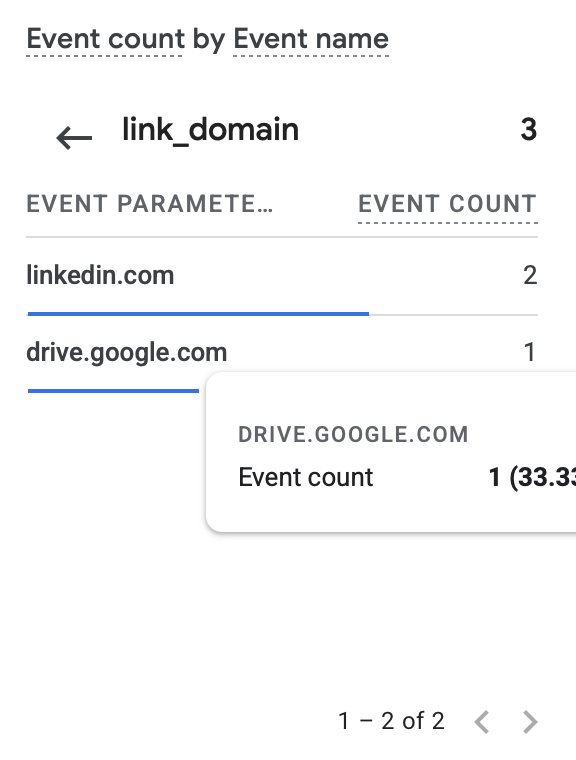
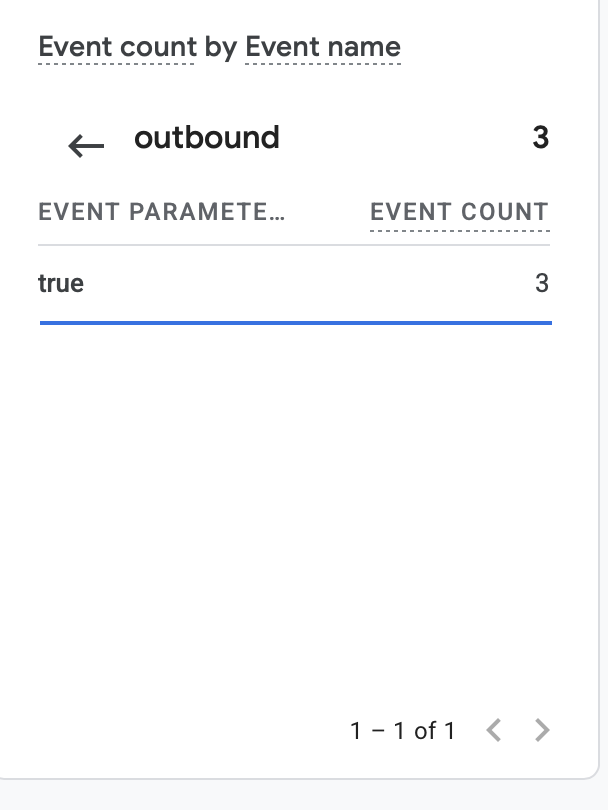

# Exercise 06 Evidence

## 1. Email tests

Mailbox: `ellie@elliemcgough.me` (Zoho Mail). Outside mailbox:
`elliemcg30@gmail.com` (Gmail). Times come from the `receivedTime` that Zoho
records for each message, converted to Pacific time.

| Test | Time (PDT) | Message | Result |
|---|---|---|---|
| Before MX | Oct 13, 2026, before the MX records were added at 2:34 PM PDT (Cloudflare `created_on` 21:34 UTC). Exact send time not recorded. | Message from Gmail to `ellie@elliemcgough.me`, sent while the zone had no MX records ([dns-before-zoho.md](dns-before-zoho.md)) | It never arrived. Whether Gmail later returned a bounce wasn't recorded. |
| Received | Oct 13, 2026, 2:53:55 PM | "Test 01: Inbound", from Gmail to `ellie@elliemcgough.me` | Pass. Arrived in the Zoho Inbox. |
| Replied | Oct 15, 2026, 4:38:40 PM | "Re: Test 01: Inbound", from `ellie@elliemcgough.me` to Gmail, sent with Reply in Zoho's web app. Zoho files it in the same thread as Test 01. | Pass, with a caveat. Gmail showed the sender as `ellie@elliemcgough.me`, but the reply first landed in Gmail's spam folder. |
| Sent a new message | Oct 15, 2026, 2:33:34 PM | "Test 04: Outbound via Zoho MCP", from `ellie@elliemcgough.me` to Gmail, sent with the Zoho MCP server's `sendEmail` tool | Pass. Arrived in Gmail. |

**Unresolved: the reply went to spam.** DMARC had been published since Oct 13 at 3:01 PM PDT, two days before the reply, so a missing DMARC record wasn't the cause. My understanding is that Gmail is cautious with mail from a brand-new domain with no sending history, and that this should improve as the domain keeps sending mail that passes authentication. That is an explanation, not something I've checked. The reply's own header wasn't saved, so its SPF, DKIM and DMARC results are only known for Test 04 (below). **Check to close it:** send a new reply from Zoho later, see whether it lands in the Gmail inbox, and save its `Authentication-Results` line.

## 2. SPF, DKIM, and DMARC results

These results are for the outgoing message "Test 04: Outbound via Zoho MCP".
They come from the outside mailbox: I copied the header from Gmail's "Show
original" and supplied it to the agent, because the Zoho MCP server can read
message bodies but not headers. Gmail received the message at 2:33:37 PM PDT
from `sender5-of-o52.zoho.com` (165.173.182.52).

Excerpt from the Gmail header:

```
Authentication-Results: mx.google.com;
       dkim=pass header.i=@elliemcgough.me header.s=zmail header.b=nNrvEUMK;
       arc=pass (i=1 spf=pass spfdomain=elliemcgough.me dkim=pass dkdomain=elliemcgough.me dmarc=pass fromdomain=elliemcgough.me>);
       spf=pass (google.com: domain of ellie@elliemcgough.me designates 165.173.182.52 as permitted sender) smtp.mailfrom=ellie@elliemcgough.me;
       dmarc=pass (p=NONE sp=NONE dis=NONE) header.from=elliemcgough.me
Received-Spf: pass (google.com: domain of ellie@elliemcgough.me designates 165.173.182.52 as permitted sender) client-ip=165.173.182.52;
```

| Check | Result |
|---|---|
| SPF | pass |
| DKIM | pass |
| DMARC | pass |

## 3. Live site and GA4

- Live site: https://elliemcgough.me
- Privacy page: https://elliemcgough.me/privacy



GA4 Realtime, Oct 15, 2026, 4:48 PM PDT: `page_view` (7) and `click` (3).

The click event's parameters, from the same Realtime card at 4:50 PM PDT:

| `link_url` | `link_domain` | `outbound` |
|---|---|---|
|  |  |  |

- `link_url`: `https://www.linkedin...` (2) and `https://drive.google...` (1)
- `link_domain`: `linkedin.com` (2) and `drive.google.com` (1)
- `outbound`: `true` (3)

Two of the three clicks were the LinkedIn link. The third went to a Google
Drive link, which is also outbound.

**What the click tells me.** This tells us that a user clicks on an outbound
link that led to my linkedin or a google drive link to a project. It can't
tell us why the person clicked the link and what they did on the separate site
since it takes them away from my site. My analytics are only connected to my
page.

**What was missing and what I checked.** The screenshots showed a click went
to the Google Drive page for a press kit I made but it doesn't say where they
clicked the link from. page_location under clicks tells you what page the
event occured on. I looked at it and it showed it came from the projects
page.
