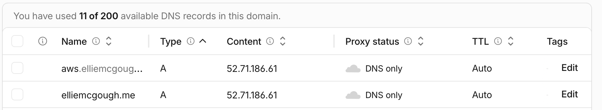
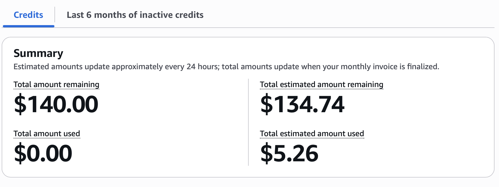

# Exercise 07: Railway → AWS (EC2 + RDS)

Site: https://elliemcgough.me · Repo: https://github.com/emcgough4/career-platform · Full records: [aws-test-subdomain.md](aws-test-subdomain.md), [aws-cutover.md](aws-cutover.md), [migration-notes.md](../migration-notes.md)

## Architecture decision

> _TODO (my words):_ I chose [architecture] over [alternative] because [priority], and I accept [tradeoff].

## Backup record

| Item | Record |
| --- | --- |
| Backup | `pg_dump -Fc` of the Railway Postgres 18.6 database, taken **2026-10-29 21:58 UTC** (`backups/railway-postgres-20261029T215819Z.dump`, 23.5 KB, 8 tables). Kept outside the repo (git-ignored) |
| Restore test | **Pass.** The dump was restored into a fresh local Postgres 18 on 2026-10-29. On 2026-11-09 it was restored into RDS from EC2 (`pg_restore` exit 0); per-table row counts and md5 checksums matched the dump exactly (profiles 1, experiences 2, education 2, skills 13, tags 13, projects 13, project_tags 27). |
| Restore time | `pg_restore` itself takes **0.05 s** (re-timed 2026-11-09 into a scratch local database). |
| Ongoing backups | RDS automated backups: daily window 03:13–03:43 UTC, **1-day retention** (the Free plan maximum), with point-in-time restore. Exports outside AWS: dumps in `backups/` on my laptop. |
| Accepted data loss (RPO) | _TODO (my words)_ |
| Accepted recovery time (RTO) | _TODO (my words)_ |

The Railway app disappeared before cutover, so the 2026-10-29 backup is the data now live on AWS. That is the backup doing its job.

## Section 10 verification

Tested 2026-11-09 on `aws.elliemcgough.me`.

| Check | Evidence | Result |
| --- | --- | --- |
| `aws` A record → Elastic IP `52.71.186.61`, DNS only, other records unchanged | `cf dns records create`. A before/after diff of the zone shows 10 records unchanged and 1 added (`proxied: false`) | Pass |
| Grey cloud on the record in the Cloudflare dashboard | Screenshot below | _TODO: checked by me in the dashboard_ |
| `nslookup aws.elliemcgough.me` answers the Elastic IP | `Address: 52.71.186.61` (also on 1.1.1.1, 8.8.8.8 and Cloudflare's own server) | Pass |
| Let's Encrypt certificate for `aws.elliemcgough.me` | Issuer `Let's Encrypt YE1`, expires 2027-02-08, curl verifies it, `certbot renew --dry-run` succeeds | Pass |
| HTTP redirects to HTTPS | `http://aws.elliemcgough.me/about` → `301 https://aws.elliemcgough.me/about` | Pass |
| Padlock in the browser | _TODO_ | _TODO: checked by me_ |
| Every page matches | 19 of 19 pages identical to the same commit run on the same data; `/no-such-page` 404, the rest 200; no fallback marker | Pass |
| Static files | 18 of 18 return 200 | Pass |
| Data served from RDS | Row counts and md5 checksums per table match the backup | Pass |
| Database outage falls back fast, then recovers | DB security group rule removed: 503 with snapshot in 5.3 s. Rule restored: 200 within 10 s, no restart | Pass |
| PostgreSQL stays private | RDS `PubliclyAccessible=False`, private IP, port 5432 unreachable from the laptop; app port 8000 unreachable from the internet | Pass |
| Reboot, real certificate renewal, load, point-in-time restore, GA4 on the new host | Not run | Not verified |

## Cutover status

**Done: 2026-11-09 04:24–04:27 UTC (2026-11-08, 8:24–8:27 PM PST).** The `elliemcgough.me` CNAME to Railway was changed to an A record → `52.71.186.61`, DNS only, and the certificate was extended to cover the root domain. `main` was merged and deployed on 2026-11-09 (`5e3bb00`).

_TODO: screenshot of the Cloudflare DNS page showing the `elliemcgough.me` and `aws` A records → `52.71.186.61` with the grey cloud._

## Cost

| | Monthly |
| --- | --- |
| Section 6 estimate (us-east-1 price list, 2026-11-03): t3.micro $7.59, db.t4g.micro $11.68, EC2 gp3 20 GB $1.60, RDS gp3 20 GB $2.30, public IPv4 $3.65, backups and data out $0 | **$26.82** |
| Billing page now (account owner's view) | _TODO: from the screenshot_ |

_TODO: one screenshot from the account owner's session showing current charges and remaining credits._
