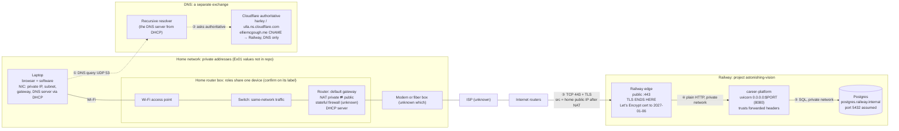
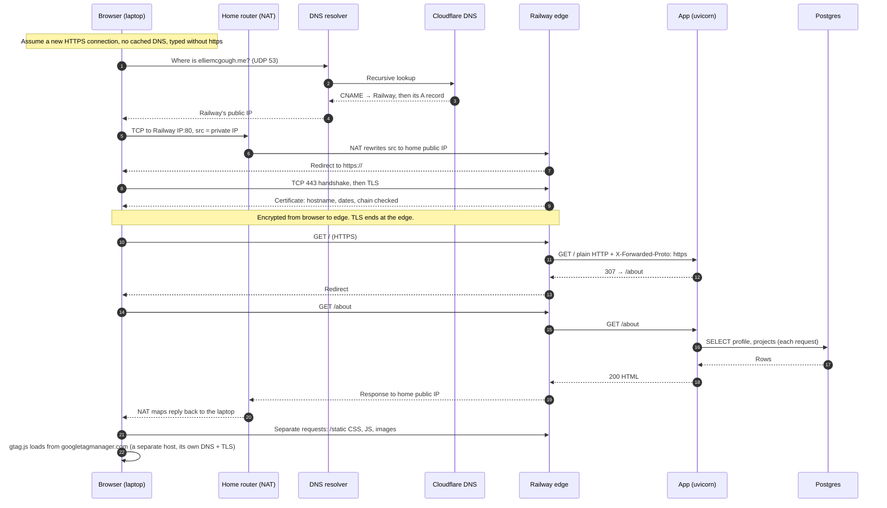
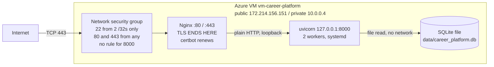

# Request path: what happens when I enter my domain in a browser

Study diagram for the midterm, drafted with Claude Code on 2026-10-20. Anything the
repository doesn't record is marked **unknown** or **assumed**. Facts come from the
README, `docs/how-this-site-is-secured.md`, `docs/evidence/dns-before-zoho.md`,
and the Azure and Railway plans under `docs/superpowers/plans/`.

## 1. Hardware with the Railway services on it (current host)

## 2. One page load in order (client → server on each line)

## 3. What changes on Azure

On Azure, DNS was an A record pointing to the VM's public IP, not a CNAME.

## Unverified

- Home equipment, ISP and Exercise 01 addresses are placeholders.
- Postgres on port 5432 is the default, not confirmed.
- The http → https redirect on Railway is the study guide's assumption, not a recorded check.
- The `307` from `/` to `/about` comes from `app/main.py`.
